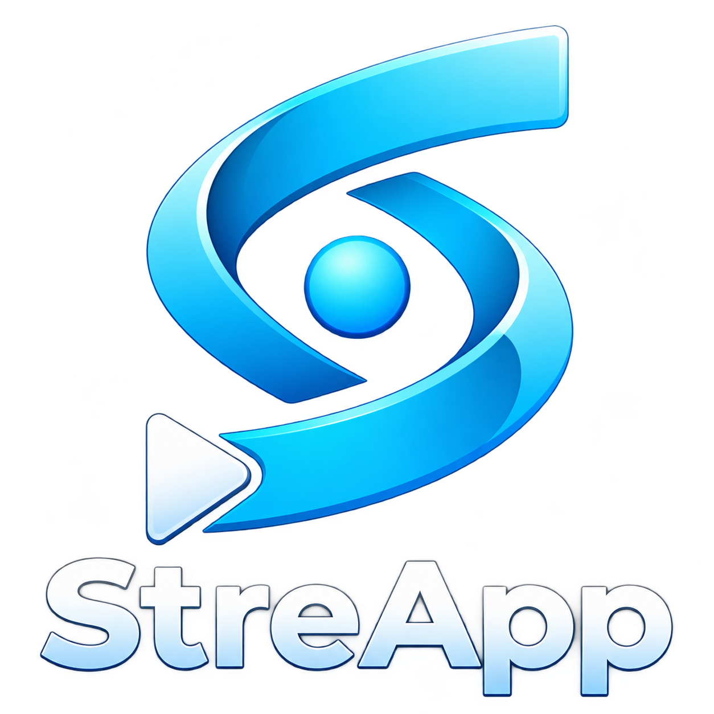

<p align="center">
  
</p>

<h1 align="center">StreApp Web</h1>

<p align="center">
  <strong>Versi web open-source dari StreApp yang terinspirasi dari OBS di browser, dibangun dengan Vue 3, TypeScript, dan Vite — 100% client-side tanpa database, siap deploy ke Vercel.</strong>
</p>

---

## Fitur Utama

- **Kompositor Multi-Sumber Real-Time:** Gabungkan Capture Card USB (UVC), Webcam, Kamera HP via Wi-Fi (WebRTC P2P), Rekam Layar/Tab/Jendela, Overlay Teks, Gambar/Logo, dan Overlay Video Loop dalam satu kanvas.
- **Kanvas Scene Interaktif:** Ketuk sumber untuk memindah posisi (dengan *snap* otomatis ke tepi/tengah), tarik 4 sudut atau gunakan slider untuk mengatur besar-kecil ukuran, pilih bentuk (**Persegi / Membulat / Bulat**), balik cermin, dan atur urutan layer.
- **Pratinjau Layar Penuh & Proyektor Multi-Layar:**
  - Mode **Layar Penuh** satu klik langsung dari pratinjau.
  - **Pilih Layar (Multi-Monitor):** Mendeteksi daftar monitor lewat *Window Management API* (Chrome/Edge) untuk menampilkan pratinjau layar penuh atau membuka **Jendela Proyektor** terpisah di monitor kedua sementara panel kontrol tetap berada di monitor utama.
- **Audio Mixer Web Audio API:** Fader gain, mute, level meter real-time, dan tiga mode monitoring (**Mati**, **Hanya Monitor**, **Monitor & Rekam**) untuk mikrofon, perangkat audio USB, dan audio tab/layar.
- **Rekaman Lokal & Penanda Waktu:** Merekam langsung menjadi MP4/WebM melalui `MediaRecorder`, dilengkapi pratinjau pemutar video dan ekspor penanda waktu (`.markers.json`).
- **Scene, Preset, & Ekspor/Impor JSON:** Tersimpan lokal di `localStorage` tanpa database, mendukung transisi **Cut** dan **Fade 0,3 dtk**, 480p–1080p (30/60 fps), serta orientasi **Lanskap (16:9)** / **Potret (9:16)**.
- **Panel Chat Privat (Baca-Saja):** Mendukung Twitch WebSocket baca-saja anonim dan mode uji tiruan — tidak pernah masuk ke kanvas atau hasil rekaman.

---

## Menjalankan Secara Lokal

```bash
npm install
npm run dev
```

## Build Produksi

```bash
npm run build
```

## Deploy ke Vercel

Proyek ini sudah dilengkapi [`vercel.json`](vercel.json) dan tidak memerlukan variabel lingkungan maupun database:

1. Unggah folder ini ke repositori GitHub Anda.
2. Buka [Vercel](https://vercel.com), pilih **Add New Project**, lalu impor repositori tersebut.
3. Klik **Deploy** (Framework Preset: `Vite`, Build Command: `npm run build`, Output Directory: `dist`).

HTTPS bawaan Vercel otomatis memenuhi syarat izin browser untuk mengakses kamera, capture card USB, mikrofon, rekam layar, dan API multi-layar.
